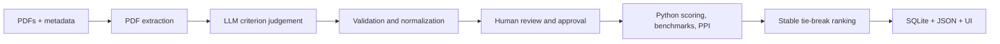

# ProcuraLens

**From proposal evidence to confident procurement decisions.**

ProcuraLens is a Streamlit classroom project for evidence-grounded PDF proposal evaluation, human review, deterministic peer benchmarking, and explainable supplier ranking.

## Architecture



The LLM judges proposal content. Python owns validation, formulas, benchmarks, PPI, tie-breaks, and rank.

## Local setup

```bash
python -m venv .venv
source .venv/bin/activate  # Windows: .venv\Scripts\activate
pip install -r requirements.txt
python scripts/init_db.py
python scripts/export_sample_run.py
pytest -q
streamlit run ProcureLens.py
```

## Demo Mode
Demo Mode requires no API key and uses bundled fictional supplier proposals. Live AI Evaluation supports user-entered provider keys, including Cohere through the official Cohere V2 SDK. Keys remain in session memory and are not stored.

## Formulas
- Absolute score: sum of `(approved score / maximum) * weight`.
- Benchmark: highest valid criterion score in the supplier batch.
- Gap: supplier score minus benchmark.
- Relative percentage: `100` when benchmark is zero, otherwise `(score / benchmark) * 100`.
- PPI: weighted average of relative percentages.
- Tie-breaks: PPI descending, earlier submission date, higher experience rating, supplier name ascending.

## Knock-out and human review
AI results of FAIL, UNCLEAR, or NOT FOUND require SME confirmation. The score chain is AI Proposed, SME Reviewed, then Procurement Approved. Procurement-approved values are official.

## Deploy on Streamlit Community Cloud
1. Push this repository to GitHub.
2. Create a Community Cloud app and set `ProcureLens.py` as the main file.
3. Deploy. Add the public URL below.

**Public URL:** _Add after deployment_

## Limitations
SQLite on Community Cloud may reset after redeployment. Blind mode does not redact identities embedded inside PDFs. Scanned PDFs may require OCR. Live mode sends extracted text to the selected provider.

## Screenshots
Add the required screenshots from `screenshots/` after deployment.
